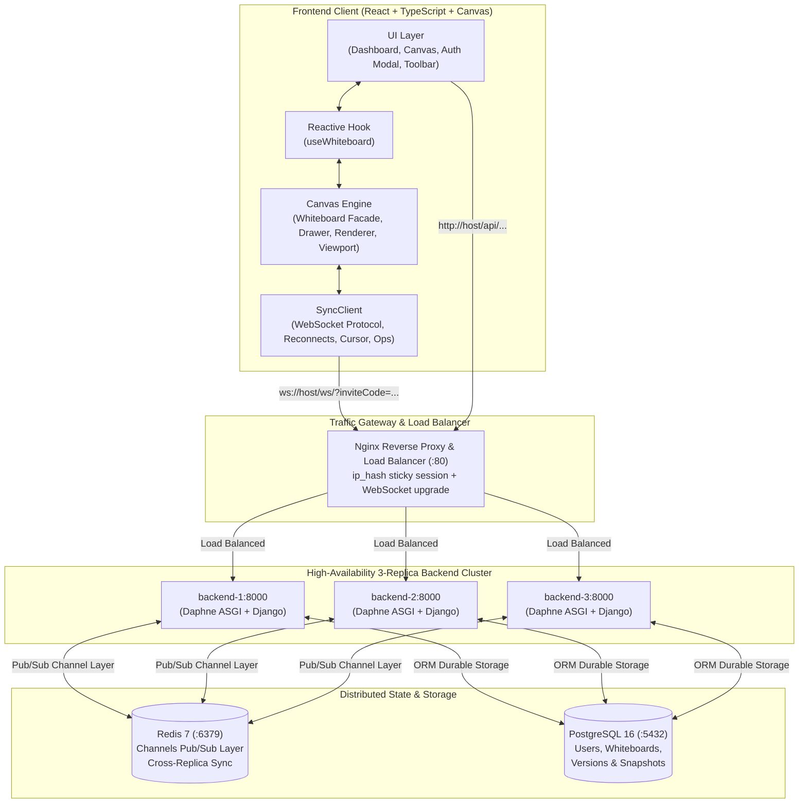
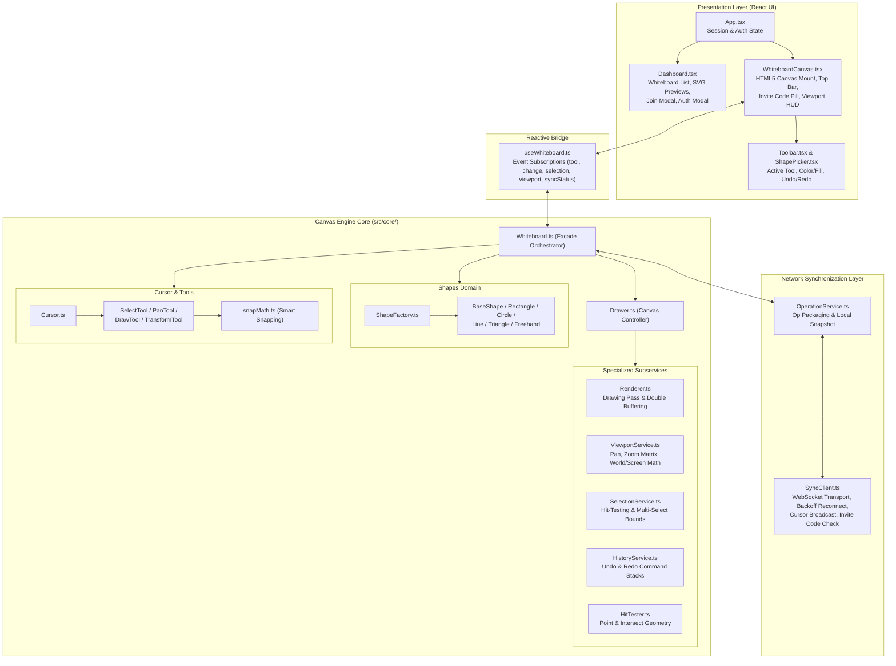
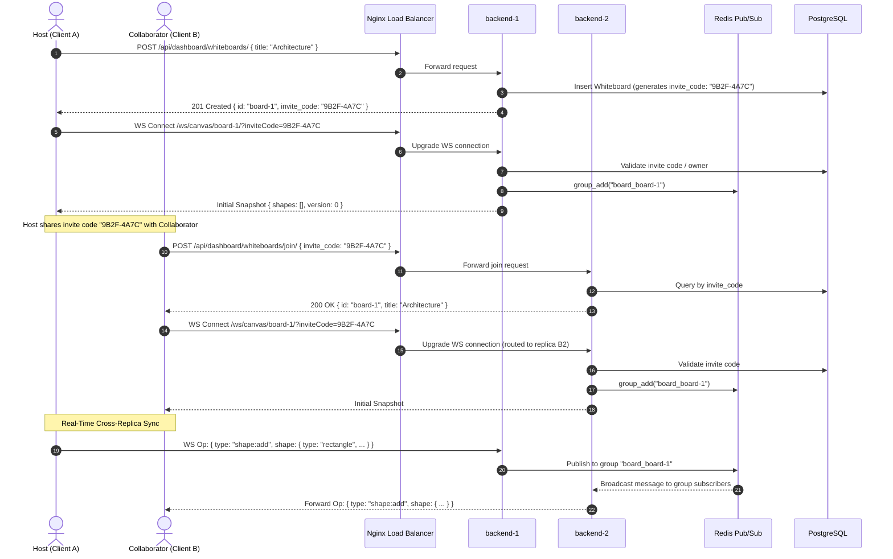

# CanvasDrawer Fullstack System Architecture

This document provides a comprehensive structural and data-flow map of the collaborative whiteboard platform, covering the **Frontend Engine**, the **Nginx Load Balancer**, the **3-Replica Django Backend**, and the **Data & Synchronization Layers**.

---

## 1. High-Level End-to-End Architecture



---

## 2. Detailed Frontend Architecture (`Drawer`)



---

## 3. Detailed Backend Architecture (`CanvasDrawerProject`)

```mermaid
flowchart TD
    subgraph Entrypoint["ASGI / HTTP Ingestion"]
        Daphne["Daphne ASGI Server (:8000)"]
        Middleware["BasicAuthMiddleware\nExtracts HTTP Basic Auth / Session"]
        Router["ProtocolTypeRouter\n(HTTP -> Django Views | WS -> Consumers)"]
        Daphne --> Middleware --> Router
    end

    subgraph RESTLayer["REST API Layer (Dashboard App)"]
        AuthViews["auth_views\n/api/dashboard/auth/login/\n/api/dashboard/auth/register/\n/api/dashboard/auth/logout/\n/api/dashboard/me/"]
        BoardViews["whiteboard_views\n/api/dashboard/whiteboards/\n/api/dashboard/whiteboards/join/\n/api/dashboard/whiteboards/<id>/"]
        VersionViews["version_views\n/api/dashboard/whiteboards/<id>/versions/\n/api/dashboard/whiteboards/<id>/restore/<ver>/"]
        Router -->|HTTP /api/| RESTLayer
    end

    subgraph WSLayer["WebSocket Real-Time Layer (WebSockets App)"]
        Consumer["CanvasConsumer (AsyncWebsocketConsumer)\n- Handshake & extract_invite_code\n- Room group_add(board_<id>)\n- Broadcast distribution\n- Session closure snapshot save"]
        Router -->|WS /ws/| Consumer

        subgraph WSServices["Domain Services"]
            WBSvc["WhiteboardService\nRoom resolution, validation,\naccess check via invite code"]
            ShapeSvc["ShapeService\nIn-memory active board shapes,\nversion mutations"]
            Types["types.py (Protocol Messages)\nsnapshot, shape:add, shape:update, cursor:move"]
        end

        Consumer <--> WBSvc
        WBSvc <--> ShapeSvc
        WBSvc <--> Types
    end

    subgraph EngineLayer["Database Engine Facade (DatabaseEngine)"]
        EngineFacade["DatabaseEngine (Engine.py)\nCentralized sync & async bridge"]
        Repo["WhiteboardRepository\nCRUD, .select_related('owner'),\nverify_access, rollback, snapshot saves"]
        SessionMgr["SessionManager\nActive in-memory channel participants"]
        UserSvc["UserService\nIdentity resolution (Auth vs Guest)"]

        RESTLayer <--> EngineFacade
        Consumer <--> EngineFacade
        WBSvc <--> EngineFacade
        EngineFacade --> Repo
        EngineFacade --> SessionMgr
        EngineFacade --> UserSvc
    end

    subgraph ORMModels["Django ORM Models"]
        WbModel["Whiteboard Model\nid, title, invite_code (unique),\nowner (FK User), snapshot (JSONField),\nversion, last_closed_at"]
        VerModel["WhiteboardVersion Model\nid (UUID), whiteboard (FK),\nversion_number, snapshot (JSONField),\nsaved_by, note"]
        UserModel["Django auth.User Model\nusername, password, email"]

        Repo <--> WbModel
        Repo <--> VerModel
        UserSvc <--> UserModel
    end
```

---

## 4. Real-Time Collaboration & Invitation Sequence



